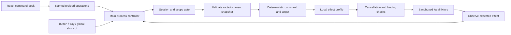

# Implemented Phase 0 architecture

Status: local-fixture foundation implemented and evaluated.
The [technical design](../Latham_Design_Document.md) defines broader contracts;
the [roadmap](../roadmap.md) defines delivery order.

## Process ownership

- The main process owns settings, controller state, local authorization, the
  executor, tray, and stop shortcut. Storage is isolated from the renderer.
- The sandboxed, context-isolated preload exposes named commands, settings and
  state subscription. IPC validates top-frame sender identity and payloads.
  It does not expose generic channels, file access or code execution.
- The React shell shows state, the last result, target summaries and a bounded
  metadata trail. It sends command strings, never authorized action objects.
- A separate WebContentsView displays the bundled fixture without a preload or
  Node integration. A fixed custom protocol map serves bundled resources;
  navigation, popup, network and permission requests are denied.
- The browser partition is in-memory. Explicit settings and opted-in diagnostic
  metadata are the application's persistent records.

## Module boundaries

| Module | Implemented responsibility |
|---|---|
| contracts | Typed states, requests/results and runtime boundary parsers |
| core | Serial queue, session scope, epochs, deadlines and cancellation fence |
| observations | Observation validation, redaction, identity/revisions |
| decisions | Bounded deterministic fixture grammar and target selection |
| actions | Reviewed fixture profiles and expected-effect assertions |
| desktop main | Concrete fixture transport, storage and guarded IPC |
| desktop renderer/preload | Command desk, settings, status and narrow bridge |

Speech, AI providers, real Chrome/native messaging, a native helper, visual
grounding and planning are not connected in Phase 0.

## Execution and cancellation

A command is scope-gated before observation. A capture receives unique target
IDs, document identity and current permission/executor epochs. The local profile
checks the target's known role/name and permitted effect. After the configured
test delay, the controller rechecks cancellation immediately before adapter
invocation; the fixture rechecks document, node identity and control revision
inside the same browser call that mutates the target.

Stop invalidates queued/delayed work and aborts waiting operations. Its local
fence is immediate because there is no separate native executor yet. Calls
already begun may still have effects; deadlines, lost replies and cancellation
preserve dispatched/unknown states and do not trigger automatic retries.
Unknown effects require reset to a freshly loaded fixture before another session.

The two-step search reacquires state between filling the field and submitting
the fixture query. Click verification requires a fresh expected result, not
merely a pre-existing success label.
