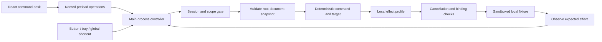

# Implemented architecture

Status: fixture, voice/providers, eight-site Chrome catalog, scoped Notepad,
hands-free, thumbnails, reviewed workflows and optional local managed accounts.
See [coverage](phase6.md), [workflows](phase7.md) and [managed AI](phase8.md).

## Phase 8 managed route

Named guarded preload operations configure invitation-account sessions and
account management. Main owns the DPAPI session, explicit saved route and Stop
generations; the renderer never receives the bearer session. Managed audio and
bounded candidate labels go through the separate loopback HTTP service to the
existing Gemini adapter using server-only credentials. No provider route is
substituted after a failure. Local/BYOK need no managed account.

The service owns hashed invitations/sessions, transactional SQLite request
reservations, rate/concurrency limits and account cancellation/deletion. It has
no browser/native/execution interface. Returned candidate IDs still pass local
policy, scope and effect verification. Offline release tooling verifies pinned
manifest signatures and archive hashes without installing anything. The service
and release tools build outside the desktop bundle. Billing is disabled;
[hosting/signing/commercial gates](release-operations.md) remain open.

## Phase 5 image ownership

Main owns non-persisted capture consent, cancellation generations, OCR/provider
selection and pending proposals. The extension gates current YouTube identity,
both site/asset grants and active epochs before reading assets. Root-only reviewed
video candidates bind DOM targets to matching public JPEG URLs. Only those
assets enter an isolated OffscreenCanvas; denied frame, overlay, field and
desktop pixels are never captured. Normalized images and minimal candidate scope
stay within the existing 64 KiB relay frame limit.

The disposable Windows OCR helper has bounded image stdin/text stdout and a
deadline, with no screen/network/path-selection interface. Visual providers see
only candidates and can return validated candidate-ID sets. One match proposes;
several clarify; none abstain. User-confirmed opening repeats target/layout/epoch
checks and uses the existing reviewed navigation/verification gateway. No model
coordinates, arbitrary click effect or silent provider fallback is introduced.
Stop, lost grants, expiry and late-result guards clear pending authority/images.
The [technical design](../Latham_Design_Document.md) defines broader contracts;
the [roadmap](../roadmap.md) defines delivery order.

## Process ownership

- The main process owns settings, controller state, local authorization, the
  executor, tray, and stop shortcut. Storage is isolated from the renderer.
- The sandboxed, context-isolated preload exposes named commands, settings and
  state subscription. IPC validates top-frame sender identity and payloads.
  It does not expose generic channels, file access or code execution.
- The React shell shows state, the last result, target summaries and a bounded
  metadata trail. It sends command strings, never authorized action objects.
- A separate WebContentsView displays the bundled fixture without a preload or
  Node integration. A fixed custom protocol map serves bundled resources;
  navigation, popup, network and permission requests are denied.
- The browser partition is in-memory. Explicit settings and opted-in diagnostic
  metadata are the application's persistent records.

## Module boundaries

| Module | Implemented responsibility |
|---|---|
| contracts | Typed states, requests/results and runtime boundary parsers |
| core | Serial queue, session scope, epochs, deadlines and cancellation fence |
| observations | Observation validation, redaction, identity/revisions |
| decisions | Bounded deterministic fixture grammar and target selection |
| actions | Reviewed fixture profiles and expected-effect assertions |
| desktop main | Concrete fixture transport, storage and guarded IPC |
| desktop renderer/preload | Command desk, settings, status and narrow bridge |

Broad native-app coverage and general model planning remain later work. Scoped
visual matching and deterministic workflows have their own guides. The diagram
above describes the fixture path only; website actions are below.

## Phase 2 page path

`BrowserController` owns page intents, provider selection, literal dictation,
clarification and cancellation. It never accepts renderer-provided selectors,
scripts or authorized actions. Known commands bypass models. Candidate proposals
must pass the profile/ID parser before reaching Chrome.

The MV3 worker checks current active tab/window, effective grants, epoch and
connection incarnation before invoking the isolated root-frame agent. The agent
enumerates only compiled Google/YouTube profiles, stores exact node references
and private field revisions locally, and returns bounded labels/IDs. No frame
contents or field values enter selection payloads. Dynamic root Chrome document
IDs prevent stale injection into a replacement page. Retired connection sessions
cannot revive an older action; acknowledged Stop clears transient scopes.

Search/filter/video commands compile reviewed read-navigation URLs, avoiding
unreviewed site handlers. Navigation verifies origin/path/query and reviewed
search structure; field edits verify value/focus/revision again after 100 ms.
Dictation binds before capture, requires explicit preview insertion and preserves
that binding while the user moves to Latham's microphone window. Real field
changes/user edits suspend it. Undo/correction require the unchanged owned edit.

Potential mutations persist an uncertainty marker before dispatch. A missing
reply, failed verification or crash cannot reset that marker; explicit inspection
and a confirmed fence are required before resuming. There is no mutation replay.
The main UI opens on voice/Chrome, with fixture tools explicitly optional.

See [Phase 2 setup](phase2.md) for exact supported operations and release limits.

## Phase 3 native path

`DesktopController` owns app approval/block choices, transient window choices,
binding IDs, durable mutation uncertainty and the single pending desktop request.
The renderer receives named operations and bounded local title/ID summaries;
it cannot submit executable paths, native handles, arbitrary keys or UIA queries.
The existing voice turn captures either its Chrome or native binding ID before
recording, and explicit insertion must match that binding afterward.

`Latham.DesktopAgent.exe` contains a supervisor with no UIA calls or windows.
It delegates UIA to a disposable non-window-owning MTA worker over inherited
stdio. A current-user-only event provides the priority cancellation fence.
The supervisor reads Stop independently of provider calls, signals the fence,
terminates the worker and acknowledges its exit. Node deadlines use the same
path; the worker exits if its supervisor dies. No action is replayed on restart.

Compiled profiles accept standard non-elevated same-user Notepad windows only.
Window/process-instance metadata is checked before UIA traversal. Traversal is
bounded to 180 nodes/15 levels; only the visible ordinary editor is bound.
Before effects the worker validates root/control identity, UIA runtime ID,
window/document title, GUI-thread focus, edit revision and expected value.
Targeted ValuePattern editing or the reviewed exact Notepad RichEdit handle
gets a second readback after 150 ms. WinEvent focus/value/destroy notifications
invalidate bindings without inspecting other apps' contents.

App permission, a block override and uncertainty persist in `desktop.json`.
Field values/undo state live only in worker memory. Switching adapters waits
for the prior executor's fence and refuses unresolved mutations. All physical
Stop paths now cover fixture, speech, Chrome and desktop. The native fixture is
test-only and excluded from portable packages. See [Phase 3 setup](phase3.md).

## Phase 4 audio ownership

The command desk exposes an explicit microphone/session opt-in. Its bounded
PCM frames carry a main-owned session ID and monotonic sequence. Main performs
simple energy VAD, serializes final commands and routes them through the existing
permission/verification adapters. Ordinary audio is discarded while busy. Wake
waiting never calls cloud or command ASR; wake pre-roll is discarded.

Separate Framework 4.8 System.Speech processes recognize only “stop assistant”
and optional “hey Latham” using the installed offline en-US recognizer. The stop
process receives frames during command ASR, execution and verification. Neither
detector can authorize actions. Ready/health/progress messages, bounded pipes,
audio deadlines, track failure and idle/total limits fail closed and end capture.
Main generations reject late finals/results after Stop. No assistant TTS path
is enabled. Model preflight and language/vocabulary/thread controls retain
memory-only local Whisper subprocesses without a resident model service.
See [Phase 4 setup](phase4.md) for exact states, timeouts and measured limits.

## Phase 1 ownership

The renderer owns bounded audio capture and physical press/release. It sends
PCM16 through named preload operations. Main owns turn IDs, abort/deadline
signals, final transcripts, provider routing and Windows DPAPI key storage.
Gemini requests originate only in main; local mode uses a trusted whisper.cpp
child and fixed loopback Ollama endpoint, with no cloud fallback. Provider
output is a validated candidate ID/abstention, never an authorized action.

The Chrome MV3 worker owns optional host grants and actual tab API calls.
Explicit popup gestures request access; main consent and Chrome grants are
reconciled on connection/removal. The independently implemented C# host only
frames stdio/duplex-pipe messages. Pairing checks the extension origin and a
session token in a current-user-only config directory.

Chrome execution has its own epoch and single outstanding request. Stop
invalidates it locally, then the extension acknowledges the paused epoch.
UI reports an unconfirmed fence until that acknowledgement arrives. Unknown
in-flight effects block resume until the user inspects Chrome and clears the
uncertain result. Disconnects never replay commands. All physical Stop entry
points cancel fixture, speech, Chrome and desktop work together.

See [protocol and data destinations](phase1.md) and [evaluation](evaluation.md).

## Execution and cancellation

A command is scope-gated before observation. A capture receives unique target
IDs, document identity and current permission/executor epochs. The local profile
checks the target's known role/name and permitted effect. After the configured
test delay, the controller rechecks cancellation immediately before adapter
invocation; the fixture rechecks document, node identity and control revision
inside the same browser call that mutates the target.

Stop invalidates queued/delayed work and aborts waiting operations. Its local
fixture fence is immediate because that path has no separate native executor. Calls
already begun may still have effects; deadlines, lost replies and cancellation
preserve dispatched/unknown states and do not trigger automatic retries.
Unknown effects require reset to a freshly loaded fixture before another session.

The two-step search reacquires state between filling the field and submitting
the fixture query. Click verification requires a fresh expected result, not
merely a pre-existing success label.
